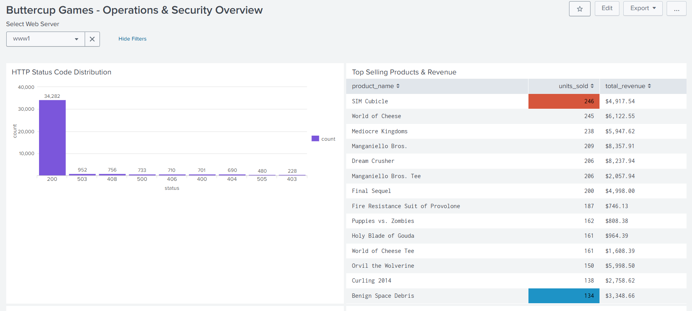
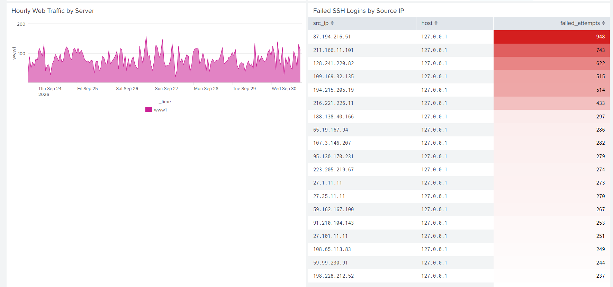

# Enterprise Web & Security Operations Monitoring Dashboard (Splunk SIEM)

An end-to-end **Splunk Enterprise** log analysis and SIEM monitoring dashboard built to track multi-server web traffic health, e-commerce revenue telemetry, and SSH brute-force authentication threats.

---

## Dashboard Preview

### Operational Health & Revenue Analytics


### Web Traffic Trends & SSH Threat Detection


---

## Architecture & Data Sources
* **SIEM Platform:** Splunk Enterprise 10.4 (Classic Simple XML Dashboard)
* **Log Sources:** Multi-tier Apache web access logs (`access_combined_wcookie`), Linux authentication logs (`secure.log`), and vendor sales records spanning `www1`, `www2`, `www3`, and `mailsv` (Splunk Enterprise Tutorial Dataset).
* **Data Enrichment:** File-based CSV lookup table (`Prices_lookup` mapped to `prices.csv`) correlating `productId` fields with product names and unit pricing.
* **Interactive Controls:** Dynamic dropdown input token (`$Server_token$`) enabling real-time filtering across individual web servers (`www1`–`www3`) or aggregated infrastructure traffic.

---

## Dashboard Panels & SPL Queries

### 1. HTTP Status Code Distribution (Operational Health)
Tracks web server HTTP response codes across 39,500+ events to monitor service availability (`200 OK`: 34,282) and isolate client/server anomalies (`503`: 952, `408`: 756, `500`: 733, `404`: 690).
```spl
index=buttercup_games sourcetype=access_combined_wcookie
| stats count by status
| sort - count